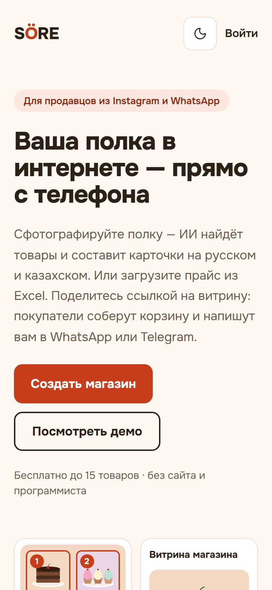
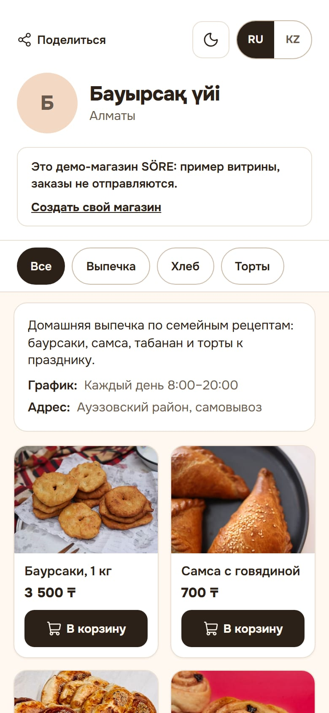
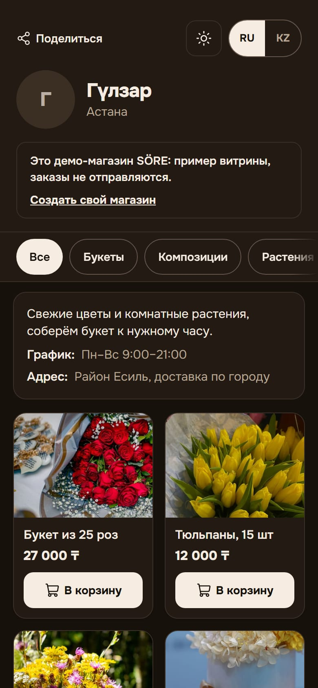
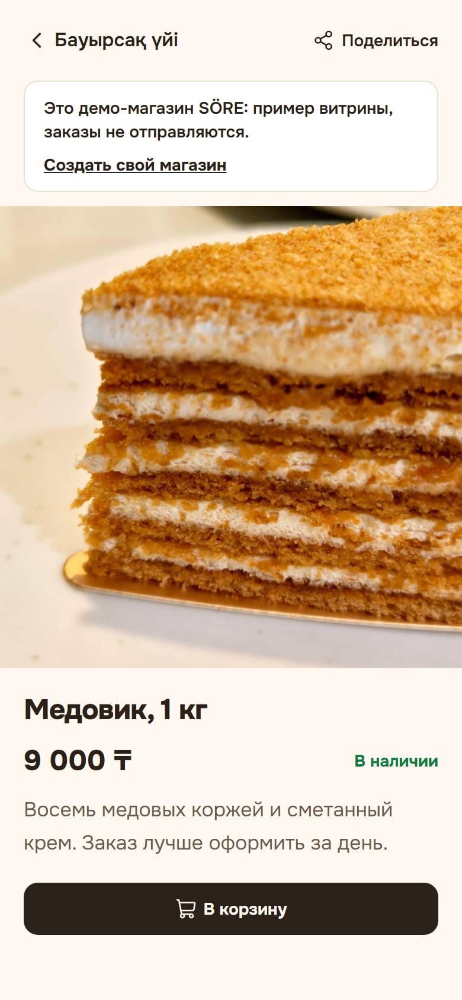
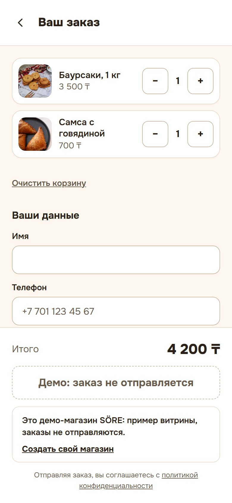
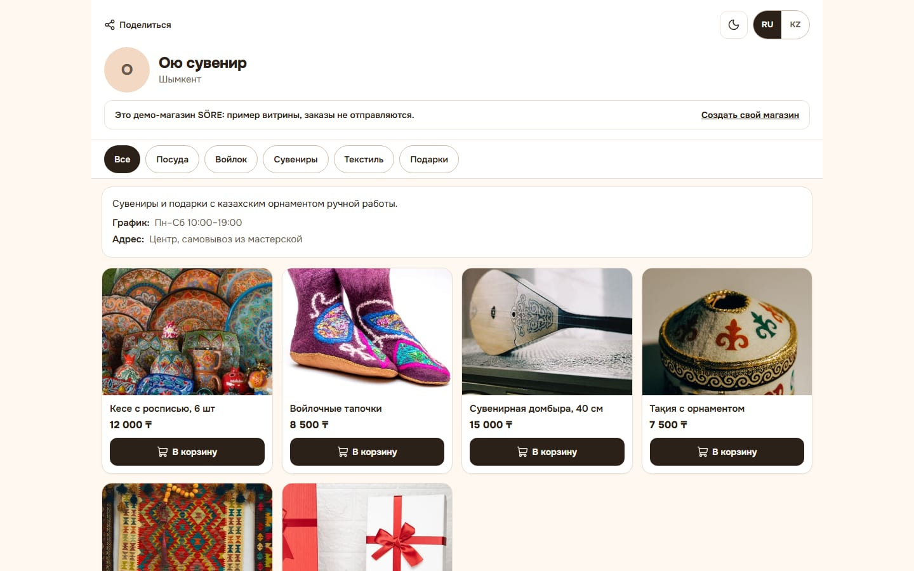
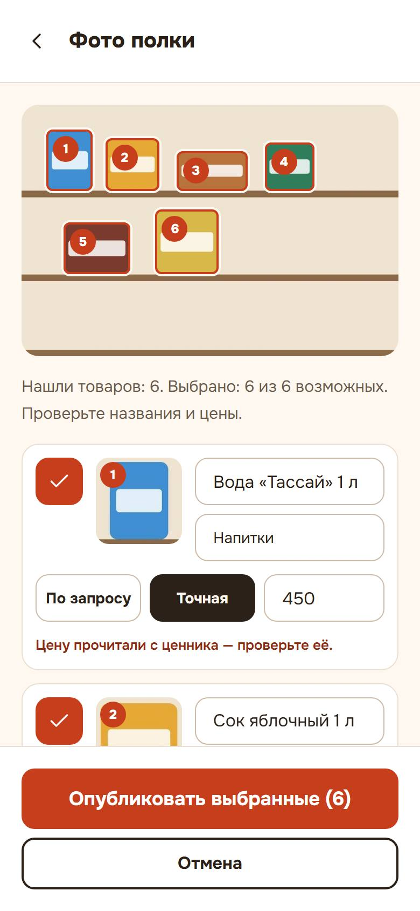

# SÖRE

**Магазин-ссылка для микропродавцов Казахстана.** Сфотографируйте полку или загрузите прайс, ИИ напишет карточки на русском и казахском, покупатель соберёт корзину по ссылке и напишет вам в WhatsApp или Telegram. Без приложения, без сайта на конструкторе, без бота для покупателя.

«Сөре» по-казахски «полка».

[](https://github.com/temirkhanerbolatovich-coder/sore/actions/workflows/ci.yml)

**Статус:** MVP на боевой среде, идёт пилот. Сайт: https://sore-kz.netlify.app (адрес сменится вместе с доменом; старый dukenai.vercel.app перенаправляет). Репозиторий приватный, лицензия не определена.

## Что умеет

| Для продавца | Для покупателя |
|---|---|
| **Фото полки:** одно фото, ИИ находит до 12 товаров, вырезает фото каждого, пишет карточки RU/KZ. Продавец правит и публикует выбранные | Витрина по ссылке и QR: поиск, категории, русский и казахский, светлая и тёмная тема |
| **Прайс из Excel/CSV:** шаблон, заголовки на русском и казахском, обновление по артикулу, отчёт об ошибках | Корзина и заказ в два поля, цены считает сервер |
| **Карточки по фото:** одно или несколько фото, ИИ-описание | Заказ уходит в WhatsApp, а при желании и в Telegram продавца |
| **Заказы:** поиск, статусы, выгрузка CSV, уведомления в Telegram | Страница статуса заказа по секретной ссылке |
| **Бот SÖRE в Telegram:** фото полки и прайс прямо из чата, QR-код, заказы с кнопками статуса | |
| **Печатный QR-плакат** для магазина | На карточке товара видно, где он стоит на полке |

## Скриншоты

Снято с боевого сайта на [демо-магазинах](https://sore-kz.netlify.app/demo-bauyrsak), телефон 390 px.

| Главная | Витрина | Тёмная тема | Карточка товара | Корзина |
|---|---|---|---|---|
|  |  |  |  |  |



**Кабинет продавца**

| Фото полки: ИИ нашёл товары | Импорт прайса из Excel |
|---|---|
|  |  |

Демо-магазины вымышленные, фото со стока Pexels; заказы из них не отправляются. Заполняет их `npm run seed:demo`, снимки обновляет `npx tsx scripts/readme-screenshots.ts`.

## Как устроено

- **Сайт и API:** Next.js 16 (App Router), React 19, TypeScript, Tailwind CSS 4. Хостинг: Netlify (подробнее docs/NETLIFY.md).
- **База, вход, файлы:** Supabase (Postgres с RLS, Auth, Storage). Цены, лимиты и квоты считает база, а не клиент.
- **ИИ:** цепочка провайдеров Gemini, OpenRouter и Anthropic с резервированием квоты на каждый запрос.
- **Каналы:** WhatsApp (ссылка `wa.me`), Telegram (уведомления продавцу через бота, ссылка на личный чат для покупателя).
- **Эксплуатация:** `/api/health` (проверка живости и базы), монитор UptimeRobot, счётчик посетителей Umami без cookie (включается `NEXT_PUBLIC_UMAMI_ID`), ежедневные зашифрованные резервные копии базы в GitHub Actions.
- **Тесты:** Vitest (юнит), pgTAP (политики RLS), Playwright (e2e на настоящем локальном Supabase).

Подробно: [docs/ARCHITECTURE.md](docs/ARCHITECTURE.md).

## Быстрый старт

Нужны **Node 24**, **Docker Desktop** (Linux-контейнеры) и **Git**.

```sh
git clone https://github.com/temirkhanerbolatovich-coder/sore.git
cd sore
npm ci
npx supabase start -x studio,edge-runtime,logflare,vector,realtime,imgproxy,supavisor
```

Миграции и демо-данные (`demo@sore.kz`, магазин `/demo`) применятся сами. Затем создайте `.env.local` из `.env.example` и впишите три значения из `npx supabase status -o env`: `API_URL` (в `NEXT_PUBLIC_SUPABASE_URL`), `ANON_KEY` и `SERVICE_ROLE_KEY`. Ключи ИИ необязательны: без них карточки заполняются вручную.

```sh
npm run dev      # http://localhost:3000
```

Локальная почта (письма входа): http://127.0.0.1:54324. Полная инструкция для Windows и частые проблемы: [docs/ONBOARDING.md](docs/ONBOARDING.md).

## Команды

| Команда | Что делает |
|---|---|
| `npm run dev` / `build` / `start` | разработка, сборка, запуск сборки |
| `npm run lint` / `typecheck` | ESLint и TypeScript |
| `npm test` | юнит-тесты (Vitest) |
| `npm run test:rls` | SQL-тесты политик доступа (нужен запущенный Supabase) |
| `npm run test:e2e` | e2e (Playwright): сначала `npm run build`, затем сам запускает production-сервер на порту 3100 |
| `npm run ai:check -- фото.jpg` | проверка ключей ИИ на настоящем фото |
| `npm run telegram:setup` | регистрация вебхука бота, меню команд и адреса уведомлений |
| `npm run bot` | бот SÖRE локально (long polling), см. [docs/TELEGRAM.md](docs/TELEGRAM.md) |
| `npm run funnel -- --allow-remote` | воронка продавцов по боевой базе (магазин → товар → просмотры → заказ) |
| `npm run seed:demo` | демо-магазины (вымышленные); `-- --allow-remote` для облака |

Перед каждым PR: `npm run lint`, `npx next typegen && npm run typecheck`, `npm test`, а при правках SQL ещё `npm run test:rls`. CI повторяет всё это на GitHub, включая сборку и e2e.

## Структура репозитория

```
src/app/            страницы и API (App Router): витрина, кабинет, заказы, импорт, ИИ, Telegram
src/components/     общие компоненты: иконки, тема, корзина, рамки на фото
src/lib/            логика без привязки к страницам: ИИ, импорт, заказы, фото, Telegram
supabase/           миграции, сид, SQL-тесты (pgTAP), config.toml
tests/              unit/ (Vitest) и e2e/ (Playwright)
docs/               документация (индекс: docs/README.md)
scripts/            служебные скрипты: проверка ИИ, пилот, вебхук Telegram
.github/            CI, резервные копии базы, шаблоны PR и Issues, Dependabot
```

## Как работать с репозиторием

- Основная ветка разработки **`develop`**, боевая **`main`** (с неё Netlify сам выкладывает сайт). Работаем в ветках от `develop`, в `main` попадает релиз через PR из `develop`.
- Коммиты и PR на русском, формат `тип(область): суть` (`feat(shelf): …`, `fix(import): …`, `docs: …`).
- Задачи ведём в [Issues](https://github.com/temirkhanerbolatovich-coder/sore/issues) с метками и вехами (**Запуск (MVP)**, **Telegram-бот**).

Правила и чек-лист: [CONTRIBUTING.md](CONTRIBUTING.md).

## Документация

Индекс всех документов: [docs/README.md](docs/README.md). Главное:

- [Архитектура](docs/ARCHITECTURE.md) и [решения](docs/DECISIONS.md)
- [Быстрый старт разработчика](docs/ONBOARDING.md)
- [Хостинг на Netlify](docs/NETLIFY.md) и [деплой, Supabase, письма входа](docs/DEPLOY.md)
- [Резервные копии базы](docs/BACKUP.md)
- [Дорожная карта](docs/ROADMAP.md) и [история изменений](CHANGELOG.md)
- [Стратегия и аналоги](docs/STRATEGY.md), [план запуска](docs/LAUNCH.md)
- [UX-аудит](docs/UX_AUDIT.md) и [план улучшений UI](docs/UI_PLAN.md)
- [Контракт для Telegram-бота](docs/BOT_CONTRACT.md)
- [Результаты проверок](docs/VALIDATION.md)

## Команда

Владелец репозитория: [@temirkhanerbolatovich-coder](https://github.com/temirkhanerbolatovich-coder). Участники: [@Aikyn800](https://github.com/Aikyn800), [@megaknight707](https://github.com/megaknight707).
